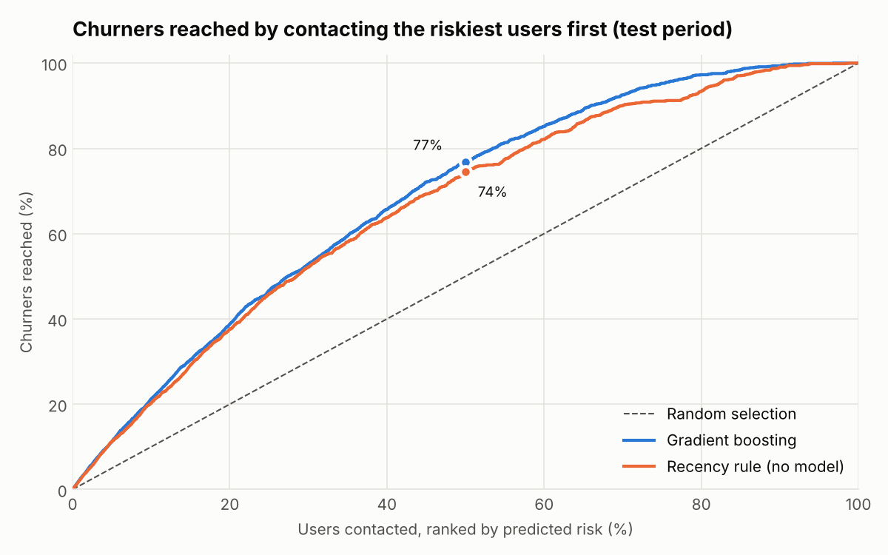
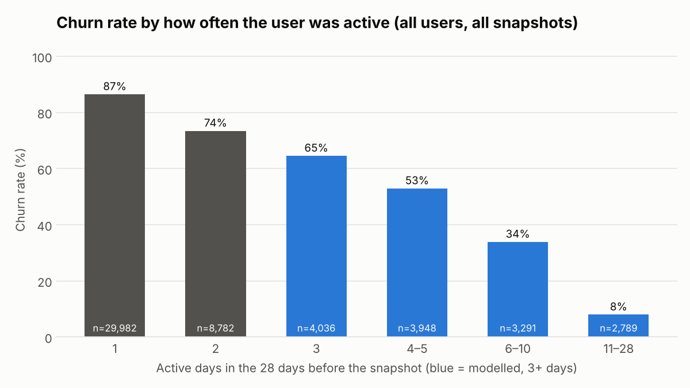
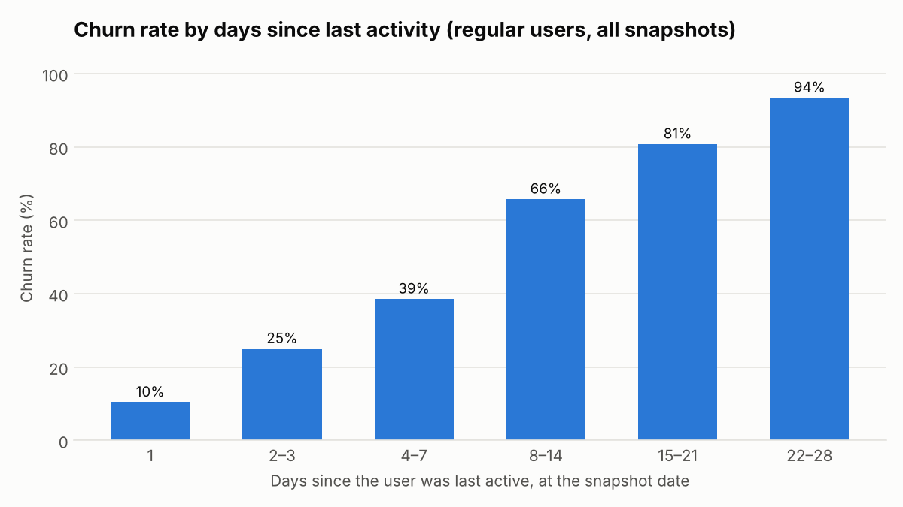
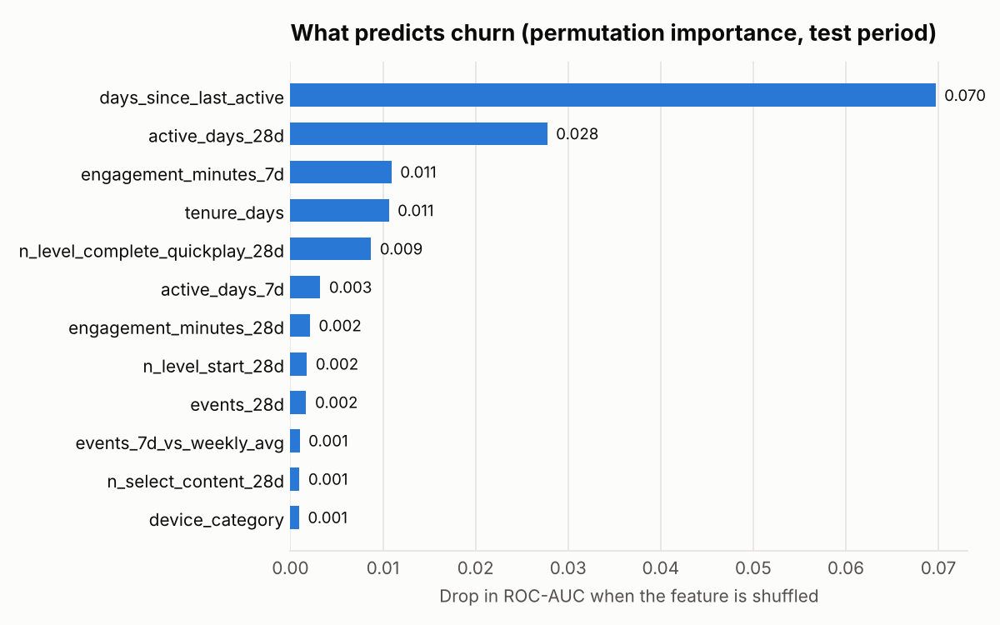
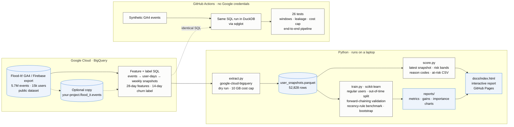
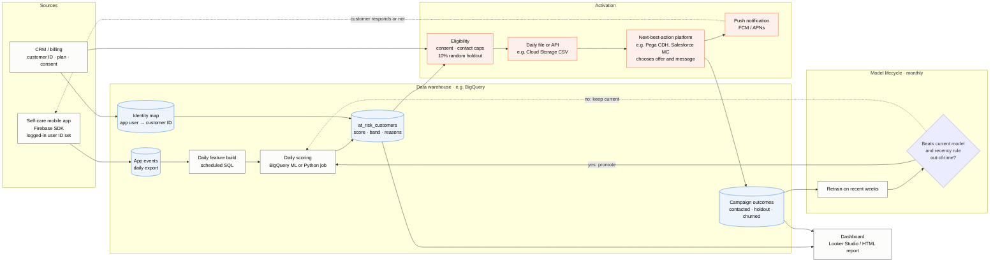

# App-User Churn Prediction from BigQuery Event Data


Predicts which app users are about to go silent, using only the raw event stream
that a Firebase / Google Analytics 4 app exports to **Google BigQuery**.

This is the set-up most consumer apps actually have: no tidy customer table, just
millions of events (`login`, `payment`, `recharge`, `level_start` ...) keyed by an
anonymous user ID. The project goes from that raw stream to a ranked list of users
to target with a retention campaign, using SQL in BigQuery for the heavy lifting and
scikit-learn for the model.

**Data:** Google's public [Flood-It!](https://developers.google.com/analytics/bigquery/app-gaming-demo-dataset)
demo dataset, obfuscated GA4/Firebase events from a puzzle game on Android and iOS
(June to October 2018), at `firebase-public-project.analytics_153293282.events_*`.

## Key results

Out-of-time test on September 2018 (3 weekly snapshots, 3,573 user-snapshots,
1,661 regular users, 38.9% churn), after training on July and August:

| | ROC-AUC | PR-AUC | Churners reached, top 10% | Top 20% | Top 50% |
|---|---:|---:|---:|---:|---:|
| Gradient boosting | **0.798** | **0.709** | 21.2% | 38.8% | 76.8% |
| Recency rule (no model) | 0.768 | 0.673 | 20.3% | 37.6% | 74.4% |
| Random selection | 0.500 | 0.389 | 10.0% | 20.0% | 50.0% |

- **The model beats the no-model rule, but modestly.** The ROC-AUC gain is +0.031
  with a 95% interval of +0.016 to +0.043 (bootstrap over users), and it wins in each
  of the three test weeks. In campaign terms that is 1 to 4 extra churners reached
  per 100 users contacted, depending on campaign size. Of the 10% of users ranked riskiest, 83% did churn, 2.1 times the
  base rate.
- **Silence is most of the story.** Days since last activity matters about 2.5 times
  more than the next feature (active days) and roughly as much as all others combined. Users last seen yesterday churn at 10%; users
  silent for three weeks or more churn at 94%.
- **Engagement level splits the base.** Across all users, 87% of one-day visitors
  churn and 8% of users active on 11+ days do. The model targets regular users (3+
  active days in 28), as a telecom retention team would; one-off visitors are an
  onboarding problem.
- **Friction events added almost nothing.** Counting fails, retries, running out of
  extra steps, errors and crashes moved test ROC-AUC from 0.794 to 0.798. Their
  signal is already captured by silence.
- **Time-blind validation overstated performance.** User-grouped cross-validation
  promised 0.888. Forward-in-time validation promised 0.824, and the September test
  delivered 0.798. Model selection here uses the time-ordered method.









## Interactive report

**[Open the live report](https://GITHUB_USER.github.io/app-engagement-churn/)** (GitHub Pages)

`python -m appchurn.report` scores every regular user as of the latest snapshot and
writes one self-contained page, [`docs/index.html`](docs/index.html), with interactive
plotly.js charts:

| Section | What it answers |
|---|---|
| Summary | How many users are at risk, by band, and how many are expected to churn |
| At-risk users | Who to contact: sortable, filterable list with reasons; copy IDs for a campaign |
| Reasons | Why users rank as risky (silence, falling activity, failures, errors, new users) |
| Campaign planner | How many churners a campaign of a given size reaches, vs. the simple rule and random |
| Model performance | Test results per week, the gain over the rule with its interval, and which validation method predicted the test |
| Segments | Risk mix by platform, device, country and tenure |
| Drivers | Feature importance; churn rate by days since last active |
| Calibration | Whether predicted probabilities match what happened, by decile and by band |
| Data quality | Coverage, row counts, placeholder values handled, data scanned |
| Method | Definitions and caveats in plain language |

**Scoring like production.** The scoring model is refitted only on weeks whose outcome
was already known on the score date, as a scheduled job would be. Because the public
data continues 14 days past the latest score date, the report can also show what
actually happened to that list: on the riskiest half of users, the model reached 330
of the 402 users who churned, against 303 for the recency rule and about 201 at random.
The exported list ([`reports/at_risk_customers.csv`](reports/at_risk_customers.csv))
never contains outcomes.

**Demo dates.** The page shows dates shifted forward 365 weeks (18 Sep 2018 is shown as
Tue 16 Sep 2025) so it reads as current. Weekdays are preserved, a banner on the page
says so, and every figure comes from the real 2018 data. Set `DISPLAY_SHIFT_WEEKS=0` to
show the original dates. No events or users are simulated.

## Architecture



### From prototype to production

The same approach, run daily at a telecom operator: scheduled scoring, monthly
retraining behind a promotion gate, consent and a random holdout before any message
is sent, and campaign outcomes fed back for measurement. Generic and vendor-neutral;
product names are examples. Design decisions are in
[`docs/architecture.md`](docs/architecture.md).



## Why a game dataset is a fair stand-in for a telecom app

The export schema is identical for every Firebase/GA4 app: one row per event with
`event_name`, `event_params`, `user_pseudo_id`, device and geography. Only the event
names differ. Swapping the list of "journey" events in
[`config.py`](src/appchurn/config.py) points the whole pipeline at a different app.

| Signal in this project | Flood-It! event | Equivalent in a telecom self-care app |
|---|---|---|
| Core usage | `level_start_quickplay` | Login, dashboard / usage view |
| Spending | `spend_virtual_currency`, `in_app_purchase` | Recharge, bill payment, bundle purchase |
| Add-ons | `use_extra_steps` | Data add-on, roaming pack |
| Promotions | `ad_reward` | Offer redemption, rewards |
| Social / referral | `challenge_a_friend` | Refer a friend, family sharing |
| Silence | days since last active | Days since last login or top-up |
| Fading | last 7 days vs. 28-day average | This week's usage vs. normal |
| Friction | `level_fail_quickplay`, `level_retry_quickplay` | Failed or retried payment or recharge |
| Running out | `no_more_extra_steps` | Data bundle or balance exhausted |
| Errors | `error`, `app_exception` | App errors, crashes, failed transactions |
| Breadth of use | `select_content`, `level_start`, `level_up` | Browsing plans, a second product, upgrading |
| Leaving for good | `app_remove` | App uninstall, port-out, line deactivation |

The weak spot: a game is not a telecom service. In-app spend here is negligible
(27 purchases in four months), so revenue features carry no signal, unlike a telecom
app where payments and recharges are central. The method transfers; the specific
results do not.

## How it works

```
BigQuery (raw events, one row per event)
   │  SQL: collapse to one row per user per day          ← only step that scans raw data
   │  SQL: weekly snapshot dates T
   │       features from [T-28d, T)   label from [T, T+14d)
   ▼
user-snapshot table (one row per user per snapshot)  ──►  data/user_snapshots.parquet
   │
   │  Python: population = regular users (3+ active days in 28)
   │          out-of-time split  (train: Jul–Aug, test: Sep)
   │          forward-chaining validation for model selection
   │          benchmarks: churn rate, and a "recency rule" with no model
   ▼
model ──► gains / lift for campaign sizing, feature importance, stability per week
```

### Churn definition

At each weekly snapshot date **T**:

- **In scope:** users active on at least 3 of the 28 days before T. The SQL returns
  everyone active at least once (52,828 user-snapshots, 12,849 users); the model uses
  the 14,064 user-snapshots from 3,391 regular users.
- **Features** describe those 28 days: active days, sessions, minutes of engagement,
  counts of each journey event, spend, days since last activity, tenure, the trend of
  the last 7 days against the 28-day average, platform, country.
- **Churned = 1** if the user has *no active event* in the 14 days from T.
  Automatic events (`app_remove`, `os_update`, `app_update` ...) do not count as
  activity: an uninstall is not the user coming back.

This is the standard snapshot design for telecom churn: a fixed observation window,
a fixed future window, and a clean gap between what the model sees and what it
predicts. Day T itself belongs to the future window only, and a test checks this.

### Choices that keep the evaluation honest

- **Out-of-time test set.** The model trains on July and August snapshots and is
  tested on September, as it would be in production. A training snapshot is kept only
  if its 14-day label window ends before the first test snapshot.
- **Validation that respects time.** Models are compared by forward chaining: each of
  the last three training weeks is predicted by a model fitted only on earlier weeks
  whose labels were already known. User-grouped cross-validation is reported too, to
  show how much a time-blind method overstates (0.888 vs. 0.798 on the test).
- **Uncertainty, not just a point estimate.** The model's edge over the benchmark is
  bootstrapped by user, because the same user appears in several weekly snapshots.
- **A real benchmark.** Ranking users by "days since last seen" needs no model and
  is hard to beat. The model is only worth deploying if it clearly does better.

### Data quality issues found and handled

- BigQuery returns dates as a `dbdate` type that standard parquet readers reject; the
  extract converts them before saving.
- 12 of 52,828 user-snapshots had placeholder install dates (1970 and 1 January 2015)
  in the obfuscated export, implying tenures of up to 48 years. Installs before 2016,
  when the game's real install dates begin, are treated as unknown.
- BigQuery integers arrive as nullable `Int64`, converted to floats for scikit-learn.

### Cost control in BigQuery

- `_TABLE_SUFFIX` limits the scan to the daily tables in the date range.
- Only the needed columns are read, and events are reduced to one row per user per
  day before anything else.
- Every query is **dry-run first** to report the bytes it will scan, then runs with
  `maximum_bytes_billed` as a hard cap (10 GB by default), so a mistake fails instead
  of costing money. The full extract scans about 1.4 GB.
- Authentication uses Application Default Credentials. No key file exists in the
  repository, and `.gitignore` blocks common credential file names.

## Limitations

- **Small edge over a simple rule.** Before deploying, a team would weigh +0.03 ROC-AUC
  against the cost of running a model instead of a one-line rule. With richer data
  (payments, plan, network quality, complaints) the gap would likely widen; here the
  events mostly describe *how much* someone played.
- **Probabilities drift; rankings hold.** Over the September test the model predicted
  34% churn against an actual 39%; on the latest score date the scoring model expected
  463 churners against an actual 402. Risk bands are therefore set by rank, and
  probabilities should be recalibrated on recent weeks before any budget planning.
- **Predicts who will leave, not who can be saved.** Choosing whom to contact needs an
  uplift model trained on the results of a real retention campaign.
- **Three test weeks, one app, 2018 data.** The obfuscated export also adds
  placeholder values, which limits how far any single number should be trusted.

## Testing without Google Cloud

The production BigQuery SQL is translated with [sqlglot](https://github.com/tobymao/sqlglot)
and executed in [DuckDB](https://duckdb.org) against small, hand-built GA4-shaped
tables, including the nested `event_params` structure. The tests cover:

- window boundaries, and an event on snapshot day counting as future rather than feature
- uninstalls and other passive events not counting as a return
- journey counts, engagement minutes, revenue, recency and tenure
- an end-to-end run on synthetic users who fade out before leaving
- the cost cap being passed to BigQuery, and BigQuery date types being converted
- forward-chaining validation never fitting on the future

CI runs all of this on every push without any Google credentials.

## Project structure

```
app-engagement-churn/
├── src/appchurn/
│   ├── config.py          # table, date range, journey events, window design
│   ├── sql/
│   │   ├── user_snapshot_features.sql   # features + labels, BigQuery SQL
│   │   ├── event_profile.sql            # which events exist and how often
│   │   ├── copy_public_dataset.sql      # optional: copy the export into your project
│   │   └── __init__.py                  # renders and validates the SQL
│   ├── extract.py         # google-cloud-bigquery: dry run, cost cap, parquet cache
│   ├── features.py        # cleaning, trend features, population, time-based splits
│   ├── model.py           # pipelines, recency-rule benchmark, gains/lift, bootstrap
│   ├── train.py           # CV, final evaluation, reports
│   ├── score.py           # production scoring: bands, reason codes, at-risk CSV
│   ├── report.py          # builds the interactive report from the scores
│   ├── report_template.html
│   └── plots.py
├── tests/                 # SQL logic in DuckDB, end-to-end pipeline, extract
├── docs/
│   ├── index.html         # the interactive report (served by GitHub Pages)
│   └── architecture.md    # architecture diagrams and design decisions
└── reports/               # metrics, CV, gains, per-week results, figures
```

## How to run

You need a Google Cloud project. The free
[BigQuery sandbox](https://cloud.google.com/bigquery/docs/sandbox) is enough, no
credit card required. The pipeline reads Google's public table directly; your project
only runs (and, outside the sandbox, pays for) the queries.

**Optional: work from your own copy.** Run
[`copy_public_dataset.sql`](src/appchurn/sql/copy_public_dataset.sql) in the BigQuery
console, then set `EVENTS_TABLE=your-project-id.flood_it.events`. The pipeline works
the same on a single table as on the sharded `events_*` export.

```bash
git clone https://github.com/GITHUB_USER/app-engagement-churn.git
cd app-engagement-churn
python -m venv .venv && source .venv/bin/activate      # Windows: .venv\Scripts\activate
pip install -e ".[dev]"

gcloud auth application-default login                   # one time
export GCP_PROJECT=your-project-id                      # Windows: $env:GCP_PROJECT="your-project-id"
# export EVENTS_TABLE=your-project-id.flood_it.events  # only if you made your own copy

python -m appchurn.extract --dry-run    # how much data each query will scan (free)
python -m appchurn.extract              # run in BigQuery, save data/user_snapshots.parquet
python -m appchurn.train                # train, evaluate, write reports/
python -m appchurn.report               # score latest snapshot, write docs/index.html
open docs/index.html                    # view the report (Windows: start docs\index.html)
pytest                                  # tests, no Google account needed
```

### Using it on another app's export

1. Point `events_table`, `data_start` and `data_end` in `config.py` at the export.
2. Run `python -m appchurn.extract --profile` to list the events and their volumes.
3. Put the business-relevant events in `journey_events`.

Run it inside the data owner's own Google Cloud project: the code moves to the data,
not the other way round.

## License

MIT
