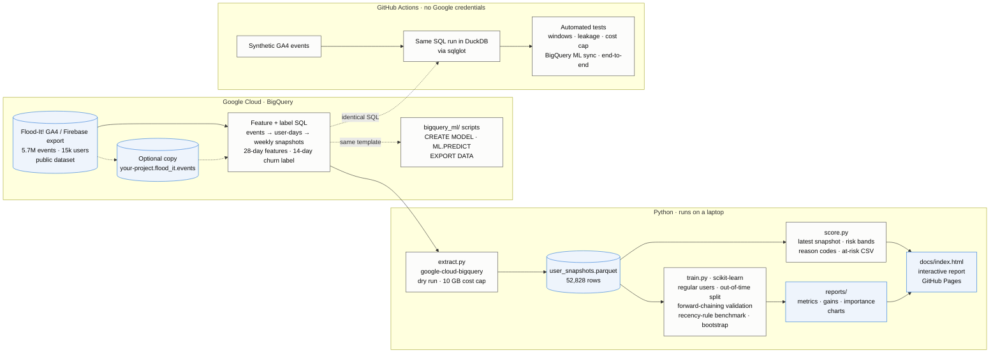
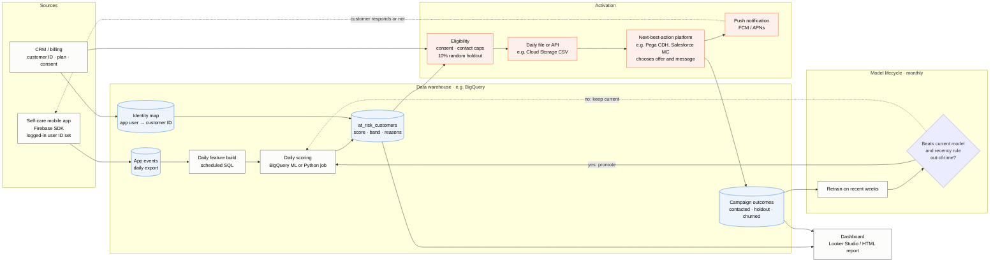

# Architecture

Two views: what this repository runs today, and a reference design for running the
same approach in production at a telecom operator. The reference design is generic and
vendor-neutral: product names are examples of a component type, not a description of
any specific company's systems.

## 1. This repository

## 2. Reference design for a telecom operator (production)

### Design decisions

| Decision | Why |
|---|---|
| Score daily on the previous complete day | The daily app export lands the following day; scoring partial data understates activity and inflates risk. |
| Identity map before activation | `user_pseudo_id` identifies an app installation, not a customer. The activation platform needs a customer or account ID. |
| Eligibility outside the model | Consent, opt-outs and contact-frequency caps are rules owned by marketing and compliance, not something a model should learn. |
| Random holdout of at-risk customers | Without a no-contact control group, a campaign's effect on churn cannot be measured. Those outcomes also enable a future uplift model. |
| Promotion gate on retraining | A new model replaces the current one only if it wins on out-of-time data, including against the simple recency rule. |
| Scores, not raw events, leave the warehouse | Personal event data stays in the warehouse; only the at-risk list with the fields the campaign needs is exported. |
